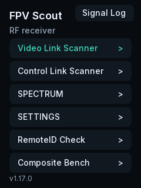
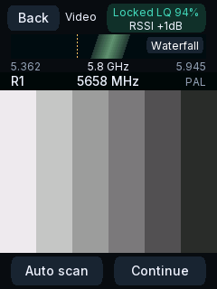
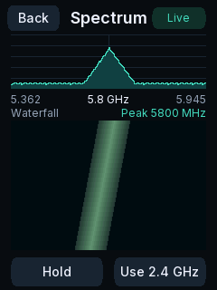

# FPV Scout - RockBase NM-CYD-C5

Standalone receive-only **FPV link scanning** on the RockBase NM-CYD-C5, with selectable portrait and landscape layouts, full-width analog video and a spectrum display.

  
  
  

Firmware-rendered previews with simulated spectrum and video data.

## Install

[Download the offline installer from the latest release](https://github.com/VALE-SOLUTIONS/FPV-Scout/releases/latest/download/FPV-Scout-Offline-Flasher.html). Open the HTML in desktop Chrome or Edge and connect the native USB-C port on the RockBase NM-CYD-C5. **Connect board** enters download mode automatically.

## Interface and receiver updates

Open **Composite Bench** from the menu to select a test pattern, change timing
and preview the picture on the CYD. **Back** stops wired output.

**Red signal indicator.** the onboard red LED blinks at
1–30 Hz while a confirmed signal is held, using uncalibrated relative spectrum
contrast. SETTINGS includes **Test LED** (1/5/30 Hz). This is not a wattage
or calibrated RSSI reading. No VTX control or broadcast mode is implemented.

- Boots directly into **Video Link Scanner** and starts an automatic sweep. The channel and position in the 48-entry sweep update as the receiver searches. Tap **Back** to open the main menu.
- Open **Control Link Scanner** from the main menu for experimental 2.4 GHz ELRS LoRa and DJI-like RF alerts. [Control link coverage](docs/scanner.md#control-link-scanner).
- Open **RemoteID Check** to scan Wi-Fi Beacon, Wi-Fi NAN and Bluetooth LE Remote ID broadcasts. [Remote ID coverage](docs/scanner.md#remoteid-check).
- Tap the plot above the video in **SCAN** to switch between **Sweep** and **Waterfall**. The tuned channel and video view stay in place.
- Open **SPECTRUM** in the main menu for the trace and scrolling waterfall together. Switch between **5.8 GHz** and **2.4 GHz** or tap **Hold** to pause the display.
- **Settings → Auto rescan** is on by default. After five seconds without horizontal sync on a held channel, a fresh automatic sweep starts. Turn it off to stay on the channel.
- During automatic searching, tap **Manual** to hold the current channel. Use the arrows around **Channel** to step either way. Tap **Auto scan** for a new sweep.
- In Manual, tap the center **Channel** button to choose a band and channel or enter a frequency directly in MHz. [Manual tuning](docs/scanner.md#controls-and-detection).
- Put PNG or GIF files in `/wallpapers` on a FAT32 or exFAT microSD card. Tap **Next image** in Settings to pick a file, or tap the mode button to cycle MAIN, ALL, and OFF. [Wallpaper details](docs/scanner.md#sd-card-wallpaper).
- Tap **Settings → Orientation** to switch between 240×320 portrait and 320×240 landscape. FPV Scout restores your last choice and keeps the touch calibration for each orientation. [Landscape scan preview](docs/img/scout-video-found-landscape.png).
- Fixed spectrum limits **5.362-5.945 GHz**, with **5.8 GHz at the visual center**. Each half has its own linear frequency scale because 5.8 GHz is not the arithmetic midpoint. An amber marker shows the tuned channel.
- A real 20-chunk band sweep supplies the spectrum; it is not a relabeled local-channel FFT. The last completed sweep stays visible while the next is acquired. Sweeping slows during a video hold and pauses during signal verification.
- Edge-to-edge video with channel, frequency and video format shown outside the picture.
- While a signal is locked, SCAN shows RSSI in dB above the receiver reference and LQ as the percentage of recent captures with valid video sync.
- Open **Signal Log** for up to 32 saved entries. Tap an entry for signal details, or use **Save to SD** to archive the active log as CSV.
- Tap a live analog picture to hide scanner controls and show the frequency, RSSI and LQ over the video. Tap again to restore the scanner.
- Auto checks all 48 predefined A/B/E/F/R/L entries, then compares the three strongest candidates with sync evidence. It ranks confirmed candidates by horizontal sync and uses signal strength to break ties. For overlapping presets, it can favor the one that decodes more clean picture rows. **Continue** excludes the last held frequency and channels within 10 MHz from the next ranking.
- The grayscale preview uses 819 µs snapshots, tracks standard and progressive field timing, and retains clean pixels through short interference bursts. During brief sync gaps it keeps the last picture visible while the decoder reacquires.

In a live CYD run, Auto swept all 48 channel entries in 299 ms and locked in 718 ms from the first channel check. See the [hardware validation](docs/validation.md#fast-sweep-and-candidate-comparison-in-rust-017).

## Use and build

- [Offline flasher build source and instructions](tools/offline-flasher)
- [Installation, recovery, calibration and controls](docs/scanner.md)
- [Validation and remaining hardware checks](docs/validation.md)
- [Recovered code and video provenance](docs/reused-sources.md)
- [Manual flash images and offsets](firmware/README.md)
- [Build from source](docs/build.md)

The firmware source is in `espsoup/`. The tagged source and pinned build instructions correspond to the firmware bundled with the offline installer.

## Credits and license

The radio backend, FFT and capture engine derive from [ESPsoup](https://github.com/pit711/espsoup-firmware) by Peter Holzhauser and contributors, based on [ESPARGOS ESP-SDR](https://github.com/ESPARGOS/esp-sdr). Their GPL-3.0-or-later source notices, [LICENSE](espsoup/LICENSE) and [NOTICE](espsoup/NOTICE) are retained.

The LCD video renderer adapts the earlier NM-CYD-C5 port of **C5VRX by Twotoz and the C5VRX contributors**, based on upstream commit `8b60fef0f43f43a5305d941568c5975386867fc0`: [canonical source](https://github.com/Twotoz/C5VRX), [official website and Discord invite](https://twotoz.github.io/C5VRX/). It reuses snapshot FM discrimination, sync timing and grayscale line placement, with provenance and changes recorded in [recovered sources](docs/reused-sources.md). FPV Scout is an independent project. The combined firmware uses [GPL-3.0-only](LICENSE). See the original [C5VRX branding terms](licenses/C5VRX-branding.md) and [component notices](docs/reused-sources.md).

Inter font assets retain their [SIL Open Font License](tools/fonts/OFL.txt), also included beside the generated atlas.
