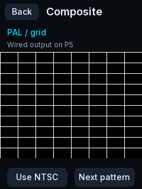

# Composite Bench on the RockBase CYD

Open **Composite Bench** from the FPV Scout main menu to start a black NTSC picture. **Next pattern** cycles black, bars, grid, ramp, half black and half white, and a moving box. **Use PAL** or **Use NTSC** changes timing. The CYD previews the same quantized samples as the wired output in either display orientation.



**Back** stops the output and frees the DMA buffer. **Unplug the composite harness from P5 before returning to receiver use.** The USB PARLIO capture and diagnostics drive GPIO4 and GPIO5. A connected monitor loads that bus and can receive its activity. The on-screen SCAN and spectrum use the internal RF dump path. While Composite Bench is open, automatic scanning is paused and the USB console declines receiver control commands. Only the touchscreen can open this mode.

## Wired output

The RockBase NM-CYD-C5 v1.0 schematic shows 100 Ω already in series on each of the P5 data lines at R5 and R6. Use external 470 Ω and 120 Ω resistors at P5 and disconnect any GPS module occupying the port. Connect the joined node and ground to one wired 75 Ω composite input. [RockBase schematic](https://github.com/RockBase-lab/NM-CYD-C5/blob/main/Documention/2-sch/SCH_NM-CYD-C5-v1.0.pdf).

```text
GPIO4 --- [100 Ω on board] --- P5 --- [470 Ω] ---+
                                                +---- composite video signal
GPIO5 --- [100 Ω on board] --- P5 --- [120 Ω] ---+
Board GND ------------------------------------------- composite ground
```

With ideal 3.3 V GPIO levels and one 75 Ω load, the four codes are approximately 0, 0.30, 0.76 and 1.06 V. These are calculated levels. Both timing families are monochrome and progressive. Some displays expect interlaced video and may fail to lock. External monitor lock and voltage still need a physical test.

With the mode open, use `BENCH black`, `BENCH bars`, `BENCH grid`, `BENCH ramp`, `BENCH levels`, `BENCH bounce`, `BENCH pal`, `BENCH ntsc`, or `BENCH status` on the existing USB console. `BENCH lvl BLACK WHITE` redraws the current pattern with adjusted two-bit picture codes where `1 <= BLACK < WHITE <= 3`. Choosing adjacent codes leaves only two picture levels. Blanking and sync are held constant. Changing format resets levels.

The output is wired composite video. The app contains no SmartAudio, VTX channel control, or transmitter activation from SCAN or LOCK.

## Build and recovery

Build with ESP-IDF 6.0.2 and the existing RockBase defaults. The RockBase defaults select the same core as the prebuilt app. Rust generates the sample buffer and handles format changes, level changes, animation and shutdown. The C bridge allocates DMA memory and calls the ESP-IDF PARLIO and GPIO drivers. See the [source build instructions](build.md) for the exact command.

On the standalone Scout partition layout, replace the application at `0x20000` using the native USB COM port. Preserve the installed app for rollback and leave the bootloader, partition table and touch calibration in place. Restore the saved app to the same address to roll back.

The CVBS generator and patterns are adapted from C5VTX through the standalone Composite Bench source and retain GPL-3.0-only. FPV Scout packs four samples into each byte, so the NTSC buffer is 41,658 bytes, one quarter of an 8-bit raster at the same dimensions. PAL uses five pulses in each of the pre-equalizing, broad and post-equalizing sections.

**C5VRX by Twotoz and the C5VRX contributors** demonstrated the passive DAC approach. The RockBase pin assignment here differs from the XIAO carrier. See the [canonical project](https://github.com/Twotoz/C5VRX) and [official site with Discord invite](https://twotoz.github.io/C5VRX/).
