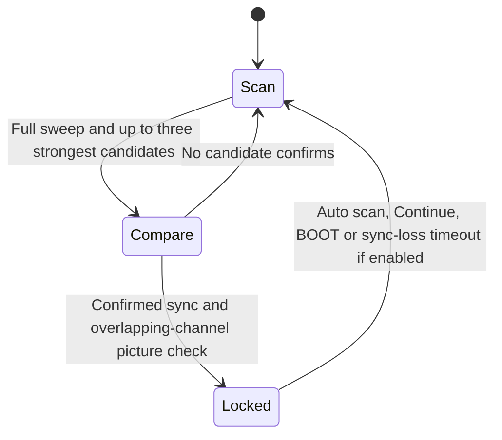

# FPV Scout guide

## Signal Log

Tap **Back** and then **Signal Log** in the upper-right corner of the main
menu. Newest entries appear first. Tap **Older** or **Newer** when the log has
multiple pages.

The log records confirmed analog video, reported digital video, likely control
links, and Remote ID activity from their respective scanner pages. Tap an
entry for frequency, band, measured strength, first logged time, last seen
time, and the most recent loss the receiver observed. Times use the boot number
and elapsed time. Remote ID entries are grouped by transport.

The active log survives restarts. At 32 entries it keeps updating existing
signals and prompts you to save or clear before adding new ones. New entries
and observed losses are saved promptly. Repeat sightings are checkpointed
periodically and when opening the log, so an abrupt power cut can leave an
older last-seen reading.

Tap **Save to SD** to create a numbered `SC000001.CSV`-style file at the root
of the card. The active log is emptied after the export is written and verified.
A failed export keeps the active log. Tap **Clear** and confirm to empty it
without an archive.

The active log is stored on the board and exported reports stay on the SD card.
Review CSV exports before sharing them. A full flash backup can include the
active log, device settings and data left by earlier firmware. Keep backups private.

[Signal Log preview](img/scout-signal-log.png) · [Signal Details preview](img/scout-signal-details.png)

## Controls and detection

In **Video Link Scanner**, tap **Manual** during automatic searching to hold the current channel. Tap **<** or **>** around **Channel** to move backward or forward. Tap **Auto scan** for a fresh sweep.

Tap the live analog picture to enter fullscreen. Frequency, RSSI, and LQ appear
as transparent text over the picture. Tap anywhere again to restore the scanner
controls. Landscape fills the panel. Portrait centers the picture to preserve its
proportions.

Tap **Channel** in Manual to open the tuner. On **Band / Ch**, choose a band and a channel from 1 to 8. On **Frequency**, enter a whole-MHz value from **5362 to 5945**. Tap **Tune** to return to SCAN on that frequency, or **Back** to keep the previous frequency. From a custom frequency, the arrows jump to the closest preset below or above it.

[Band and channel preview](img/scout-tune-channel.png) · [Frequency keypad preview](img/scout-tune-frequency.png)

Auto checks channels continuously at the fastest sweep rate. The channel
strip shows the tuned channel and progress through the 48 entries. The
**Comparing** stage then checks up to three candidates.

In **Settings**, tap **Orientation** to switch between Portrait and Landscape. The app saves the selection across restarts. Version 1.12.6 flips Landscape and maps saved landscape touch calibration to the new rotation. If that orientation has no saved touch calibration, tap and briefly hold each of the three crosses. **Calibrate touch** updates the calibration for the active orientation.

The CYD boots directly into **SCAN** and sweeps the 48 A/B/E/F/R/L channel entries from 5362 to 5945 MHz. Tap **Back** to pause scanning and open the main menu. Choose **SCAN** from the menu to resume. F8 and R7 share 5880 MHz. These are predefined channel centers; frequencies between them and other RF bands are not continuously covered.



The initial sweep takes one snapshot per channel using the ESPsoup register-level capture engine. Each snapshot contains 16,380 IQ10 samples at 20 MS/s, about 819 microseconds. The **Comparing** stage follows the full sweep. USB status measures sweep time and comparison time separately.

The phase discriminator produces 0.5 microsecond bins and tests both modulation polarities. The initial sweep admits channels with four consecutive horizontal-sync intervals or two vertical-serration intervals. Confirmation requires three qualifying horizontal-sync snapshots and a qualifying vertical-sync snapshot with the same polarity. Manual allows 400 ms for confirmation. Auto collects evidence across the comparison visits.

Auto shortlists up to three channels by centered in-band spectrum strength after checking all 48 entries. It visits each candidate twice for about 45 ms per visit and compares the average repeating horizontal-sync chain among candidates that also confirm vertical sync. Signal strength breaks ties. A confirmed contender within 6 MHz of the initial winner can take the lock if both have enough picture samples and the contender decodes at least one more clean row per snapshot on average. Nearby presets can receive the same broadcast, so the displayed preset may differ from the transmitter's setting. If none confirms, Auto sweeps again. **Continue** starts a full sweep and excludes candidates within 10 MHz of the previous hold from that sweep's ranking. **Auto scan** starts a sweep with every channel eligible.

Manual monitors the selected channel and opens the preview once sync is confirmed. **<** or **>** moves to the adjacent entry and clears the old picture. A hold uses qualifying horizontal sync from the detector or fresh video rows backed by horizontal sync from the same capture. After one second without sync the status reads **Recovering**, followed by **Sync lost** at three seconds. With **Settings → Auto rescan** on, five seconds without sync starts a fresh automatic sweep from either an Auto or Manual lock. Returning sync restarts the timer. Turn Auto rescan off to keep the receiver on the held frequency until you change it. The toggle is on by default and is saved across restarts. Press BOOT to start a fresh sweep from a hold.

The receiver collects grayscale rows in short snapshots. The preview opens
after the decoder measures the field clock and at least 95% of the viewport
fills. If the picture fills slowly, the receiver can open it at 80% coverage
after two seconds of accumulating rows.
It measures line and field timing independently to handle both standard and
integer-line progressive sources. Nearby horizontal sync pulses stabilize the
start of each row. The decoder averages small brightness changes and applies
larger changes on the first valid capture. It can place credible rows across
gaps of up to 1.25 seconds between vertical references. Interference bursts
leave the previous pixels or rows intact. Small gaps between captured rows
are blended from the neighboring rows.
After the viewport fills, the display sends only changed rows on a schedule
of up to 60 updates per second. While the preview is still filling, full
redraws run at a lower rate to leave time for incoming video.
The last decoded picture remains
visible for up to three seconds if vertical sync drops. Leaving the hold clears
the picture immediately. Spectrum retunes pause while a held channel is
recovering video. Captured PAL/NTSC video and its embedded
OSD depend on signal quality and the rows received.

Sync recognition is evidence of an analog composite video waveform. It cannot determine whether a camera scene is current or whether the transmitter carries a static screen or recording. RF power, Wi-Fi activity or a plain carrier alone do not satisfy the detector's confirmation rule. Real-world rejection performance still needs testing.

## Locked signal readouts

**RSSI** is the detected peak near the held frequency in dB above the
receiver's band-sweep reference floor. **LQ** is the percentage of the last
16 available detector checks with valid video sync.

## Digital RF alerts in 1.12.9

SCAN can show **Likely DJI O4**, **Likely Avatar**, or **Digital signal**
in the video pane. The frequency is an estimate from the spectrum. Confirmed
analog video takes priority. The alert leaves the scanner in its current
mode. In Manual, the receiver only reports activity overlapping the tuned
frequency.

The experimental detector checks that broad RF energy stays at the same
absolute frequency when the receiver retunes, repeats the check across sweeps,
and matches OFDM symbol timing before showing a family. **Medium confidence**
means the timing matched on three repeated observations. It is a qualitative
label. **Digital signal** with **Type unconfirmed** flags qualifying
wideband RF activity, which could include Wi-Fi or other traffic. Ascent and HDZero
currently have no family label. The digital checks cover 5.650–5.925 GHz
inside the existing scan. They can miss signals whose bandwidth extends
beyond the capture window. The alert
reports activity without decoding digital video.

The O4 timing check uses the 30 kHz spacing reported by
[ESPsoup](https://github.com/pit711/ESPsoup).
The Avatar check uses published symbol and prefix durations from the
[WaveShark Artosyn implementation](https://github.com/v0l/waveshark/blob/master/crates/dsp/src/artosyn/mod.rs).
The 1.12.9 board build is for bench testing. Real O4 and Avatar detection
still needs validation with powered links.

## Control Link Scanner

Open **Control Link Scanner** from the main menu. The live 2400–2490 MHz
waterfall scrolls between **ELRS LoRa** and **DJI OcuSync**.

- **ELRS LoRa** shows **Likely ELRS** after the same LoRa timing
  matches on multiple hop frequencies. The detector covers the 812.5 kHz
  LoRa modes with spreading factors 5 through 8. ELRS FLRC and sub-GHz
  modes are outside this detector's coverage. [ExpressLRS modulation table](https://github.com/ExpressLRS/ExpressLRS/blob/f8700cab6f7bfd50fe076194abdcf0e26d787e82/src/src/common.cpp) · [ELRS channel plan](https://github.com/ExpressLRS/ExpressLRS/blob/f8700cab6f7bfd50fe076194abdcf0e26d787e82/src/lib/FHSS/FHSS.cpp)
- **DJI OcuSync** shows **Likely** with an estimated frequency after repeated timing matches
  near the same frequency. This is a waveform match. It cannot tell
  which end of the DJI link the signal came from. [OnAir detector](https://github.com/adswill/OnAir/wiki/Tutorial-DJI-drones) · [DJI RC specifications](https://www.dji.com/rc/specs)

Each status card shows three readouts while there are recent matches.

- **Prob** estimates the chance of seeing the waveform again based on
  recent completed sweeps and any match in the current sweep. One
  positive and one negative prior observation keep it from jumping to
  100% after a single hit. This estimates repeatability, not protocol identity.
- **RSSI** gives received sample power in dBFS relative to the ADC full
  scale. Receiver gain can affect the reading.
- **LQ** is waveform correlation on the latest accepted capture. It
  measures how closely the samples matched the timing check. It does
  not measure packet delivery at the aircraft.

The Control Link Scanner is receive-only. **Back** stops its sweep. Choose
**Video Link Scanner** from the menu to resume video scanning.

On the CYD, the Control Link Scanner displayed **Likely ELRS** for a
RadioMaster T8L. USB status reported SF6 matches on two frequencies with
zero capture errors. The DJI timing check passed a synthetic test and
still needs a live linked controller test.

## Spectrum and waterfall

Tap the graph above the video in **SCAN** to switch between **Sweep** and
**Waterfall**. Both views share the fixed 5.362–5.945 GHz scale, centered
visually at 5.8 GHz. The amber marker identifies the tuned channel.
Each completed band sweep adds a waterfall row at the top. The current
channel and video lock stay in place when the view switches.

Open **SPECTRUM** from the main menu to see the trace, peak frequency and
scrolling waterfall together. **Hold** freezes both graphs, and **Resume**
continues the sweep. Switch to **2.4 GHz** to view 2.400–2.490 GHz, or switch
back to the FPV band. Changing bands clears the waterfall. The graphs show
relative levels, and the video receiver resumes when you return to **SCAN**.
Live updates repaint the plots and changing readouts in place. The buttons
stay visible during redraws, including when an animated wallpaper is enabled.

## SD card wallpaper

Put PNG and GIF files in `/wallpapers` on a FAT32 or exFAT microSD card.
In Settings, tap **Next image** under **Wallpaper** to cycle through files
alphabetically. The selected filename appears at the bottom of Settings,
and the selection is saved across reboots.

FPV Scout also checks the card at startup. If the folder has no choices,
the original `wallpaper.png` and `wallpaper.gif` files in the card root
still work, with PNG taking priority.

Tap the wallpaper mode button to cycle through the three saved modes.

- **MAIN** shows the wallpaper on the main menu. This is the default.
- **ALL** also shows it behind Settings, SCAN, Spectrum and Composite Bench. The graphs, controls and video previews remain in the foreground.
- **OFF** hides the wallpaper. Select MAIN or ALL to show it again.

Settings shows the last load result. Over USB, `WALLPAPER?` reads that result and `WALLPAPER RELOAD` retries from the main menu or Settings. An SD mount error means the CYD could not open the filesystem and has yet to read the image. Reload does not format the card.

The wallpaper fills the background with a centered crop in either orientation. GIFs loop on the pages where they are enabled, with frame intervals of at least 100 ms. SCAN advances GIFs at its existing UI redraw cadence. The CYD composes wallpaper and controls together before updating the display and preserves the live video area.

Files can be up to 2 MiB and 640 × 640 pixels. Artwork sized 240 × 320 or 320 × 240 fits the corresponding orientation without cropping. The RockBase's PSRAM holds the image or the cached GIF. A missing card or unreadable image leaves the default menu usable.

## Red LED in source 1.6 / Rust experiment 0.2

The NM-CYD-C5's onboard WS2812C on GPIO27 blinks red during a confirmed
Detected/Locked hold with recent sync. Its rate increases from 1 to 30 cycles/s
using the peak within ±3 MHz of the held frequency, relative to the completed
panorama's floor. The provisional scale maps ≤3 dB contrast to 1 Hz and ≥30 dB
to 30 Hz. This is a relative spectral-contrast indicator, not calibrated RSSI,
received watts, transmitter power, range or a guaranteed measure of signal quality.
AGC and the band-sweep noise estimate can affect it. At high rates it can appear
nearly steady. The sweep refreshes more slowly than the LED blinks.

The indicator turns off while scanning/checking, outside SCAN, under USB control,
on capture failure, after one second without qualifying sync, or when the last
completed spectrum is more than five seconds old. It never qualifies a hit by
RF strength alone. SETTINGS → **Test LED** runs one second each at 1, 5 and
30 Hz without a transmitter; the temporary test overrides the normal indicator
for three seconds. No transmitter is controlled and there is no INTERF mode.

Hardware timing uses an RMT output and an asynchronous timer; it does not add
sleep calls to the scan loop. Real RF correlation remains unverified without a VTX.

## Installation and recovery

For a browser install, download the [offline flasher](https://github.com/VALE-SOLUTIONS/FPV-Scout/releases/latest/download/FPV-Scout-Offline-Flasher.html) and open it in desktop Chrome or Edge. Connect the native USB-C port and select **Connect board** to enter download mode automatically. The page offers a verified stock backup before installation. See the [flasher guide](../tools/offline-flasher) for manual connection and rebuild instructions.

Use the **native ESP32 USB-C connector** and close serial monitors or flashers that could hold the port open. Find the current port with:

```powershell
python -m serial.tools.list_ports -v
```

If the old C5VRX application will not release the board, hold **BOOT**, press and release **RESET**, keep BOOT held for about two seconds, then release it. A blank display is expected in ROM download mode. If necessary, remove both USB cables and other power first, then reconnect while holding BOOT and perform the same reset sequence. The old on-screen switch is not required.

Take a fresh **full 16 MiB backup** before writing and verify it against the board. The backup includes device configuration and may contain private data; keep it locally. SD-card data and eFuses are not covered.

Run from the repository root, replacing `COMx` with the actual port:

```powershell
python -m esptool --chip esp32c5 -p COMx --before no-reset --after no-reset read-flash 0 0x1000000 current-full-16MiB.bin
python -m esptool --chip esp32c5 -p COMx --before no-reset --after no-reset verify-flash 0 current-full-16MiB.bin
python -m esptool --chip esp32c5 -p COMx --before no-reset --after watchdog-reset write-flash --flash-mode dio --flash-size 16MB --flash-freq 80m 0x2000 firmware/bootloader/bootloader.bin 0x8000 firmware/partition_table/partition-table.bin 0x20000 firmware/fpv_scout.bin
```

Flash **all three images** to migrate from the old dual-app layout. An app-only write does not replace the old partition table or boot selection. The new table has one factory app and preserves NVS at its previous address. Do not run a whole-flash erase if you want to retain touch calibration. C5VRX bytes outside the new partition map are left unused; C5VRX is no longer selectable through the scanner or its bootloader.

A watchdog reset can make Windows report that the USB device disappeared after writing. Check that **each** image reached `Hash of data verified`, allow USB to reconnect, and confirm the FPV SCOUT screen. If necessary, tap RESET with BOOT released. A disconnect message alone is not proof that the app booted.

If touch calibration is missing, tap and hold each of the three displayed crosses briefly, releasing between targets. Hold BOOT during normal power-on to recalibrate.

To restore your complete backup, enter download mode again and run:

```powershell
python -m esptool --chip esp32c5 -p COMx --before no-reset --after watchdog-reset write-flash 0 current-full-16MiB.bin
```

## Flash layout

| Partition | Offset | Size |
|---|---|---|
| NVS (touch calibration and settings) | `0x9000` | `0x6000` |
| PHY initialization | `0x11000` | `0x1000` |
| FPV Scout factory app | `0x20000` | `0x200000` |

There is no OTA selection partition or C5VRX app slot in the new table. The bootloader is at `0x2000`, and the partition table is at `0x8000`.

## Building and testing

Use **ESP-IDF 6.0.2**. From `espsoup/` after activating the SDK:

```powershell
idf.py -B build-scout -DIDF_TARGET=esp32c5 -DSDKCONFIG=build-scout/sdkconfig "-DSDKCONFIG_DEFAULTS=sdkconfig.defaults;sdkconfig.defaults.esp32c5;sdkconfig.defaults.cyd-c5" build
```

The output files are `build-scout/bootloader/bootloader.bin`, `build-scout/partition_table/partition-table.bin` and `build-scout/fpv_scout.bin`. Generated `flasher_args.json` records their offsets. The repository's prebuilt configuration is [firmware/sdkconfig.scout](../firmware/sdkconfig.scout).

With a host C compiler, from `espsoup/`:

```sh
cc -std=c11 -O2 tests/scout/test_scout.c -lm -o test_scout
./test_scout
```

Keep assertions enabled. On Windows with an activated MSVC build environment:

```powershell
cl /std:c11 /O2 tests/scout/test_scout.c /Fe:test_scout.exe
.\test_scout.exe
```

The test compiles the same detector and state code used in firmware. See [validation](validation.md) for the tested inputs and the remaining hardware work.

## Board driver and diagnostics

The existing ST7789/XPT2046 driver uses SCK 6, MOSI 7 and MISO 2; LCD CS 23, DC 24 and backlight 25; touch CS 1; SD CS 10 (held inactive); and BOOT 28. The scanner uses the SRAM IQ dump engine rather than starting C5VRX's PARLIO video path.

The display and touch driver source is in `espsoup/components/cyd_c5/`.

The read-only serial command `SCOUT?` reports version, readiness, detection state, channel, frequency, completed passes, pass time, capture counts, errors, internal heap, Auto/Manual control, the number of distinct measured video rows, RSSI, LQ, and the last comparison and lock timings. Other inherited ESPsoup host commands take a temporary lease and pause scanning. The UI resumes after five seconds of host inactivity or `RELEASE`.

Regenerate the interface previews with `python tools/make_scout_images.py` and a host C compiler. The previews use simulated receiver data.

## Typography and preview tools

The UI uses proportional Inter at 12, 14, 18 and 36 pixels, with 16 coverage levels blended into RGB565. Glyphs are precomputed in flash; the renderer uses the existing DMA band buffer and needs no full-screen framebuffer or runtime font library. The startup, touch calibration and USB-control screens use the same smooth typography.

Install the developer-only image dependency with `python -m pip install -r tools/requirements-fonts.txt`. Regenerate the atlas using `python tools/generate_scout_font.py`; Inter and its OFL license are kept in `tools/fonts/`. The generated atlas and a copy of its license live in each current display-component copy.

`python tools/make_scout_images.py` compiles the actual C font renderer and scanner drawing functions with a host compiler, checks clipping and drawing bounds, and produces all six preview states. Activate MSVC first on Windows, or provide `cc`, `gcc` or `clang` on other systems. Preview images demonstrate layout, not RF detection.

## RemoteID Check

Open **RemoteID Check** from the main menu to listen for OpenDroneID broadcasts
over Wi-Fi Beacon, Wi-Fi NAN, and legacy or extended Bluetooth LE advertisements.
The ESP32-C5 alternates passive Wi-Fi and Bluetooth listening windows on its shared
radio. Wi-Fi visits 2.4 GHz and available non-DFS 5 GHz channels, with extra dwell
on channels 6 and 149. The page shows four recent aircraft reports with their
broadcast ID when available, transport, received signal strength and age.
Reports expire after 30 seconds. **Back** releases the radio so the other
scanner pages can use it.

Broadcast IDs are self-reported, and the list reflects messages received during
the sweep. The format is based on the
[OpenDroneID reference implementation](https://github.com/opendroneid/opendroneid-core-c).

## Fixed-band spectrum above full-width video (1.4)

The top trace is measured across **5362-5945 MHz** in 20 separate 40 MS/s FFT snapshots, retaining the central 30 MHz of each. The axis is fixed, with 5.8 GHz at the visual center. Since the limits are asymmetric around 5.8 GHz, the left and right halves use separate linear scales; adjacent columns do not have equal MHz spacing across the center. The amber dashed marker shows the tuned channel. Levels are relative, not calibrated dBm.

A completed spectrum sweep remains visible while its replacement is collected. SCAN takes spectrum snapshots between channel checks and spaces them at least 200 ms apart during a video hold with fresh decoded rows. The spectrum pauses during verification and video recovery. Each chunk restores the tuned frequency, channel mode and filter, including on capture failure. Missing measurements appear as gaps.

Video fills the screen width. The channel, actual tuned frequency and video format appear above the picture in portrait and in the header in landscape. Portrait video uses 240 × 180 pixels, and landscape uses 320 × 118 pixels.

The grayscale preview uses 409.5 µs snapshots at 40 MS/s. The CYD caches measured rows and uses the nearest available row for gaps. As new rows arrive the display replaces the approximations, with rendering capped at about 15 updates per second. The detector rechecks a held channel roughly every 100 ms while video capture continues between those checks. Picture detail and refresh still depend on received sync, signal strength and snapshot coverage. See [recovered sources](reused-sources.md).

## Portrait display (1.3)

The current app uses the native 240x320 ST7789 portrait orientation (`MADCTL=0x00`). The spectrum remains above the video pane; the 240x180 4:3 pane starts at (0,100), and the controls begin at y=284. The touch split is at x=120. Geometry is shared in `scout_layout.h` by the screen, decoder and preview tests.

The first portrait boot requests three calibration taps. This calibration is stored in `cyd/tcal_portrait`; the old `cyd/tcal` landscape calibration is retained for rollback. Tap and briefly hold each cross, releasing between targets. Hold BOOT during a normal restart to repeat portrait calibration if necessary.

## Spectrum and video host checks

With an activated host C compiler, run `python tools/test_spectrum_sweep.py` from the repository root to check the actual sweep helper's receive-setting restoration on success and failure.

From `espsoup/`, test the band mapping and complete coverage:

```sh
cc -std=c11 -O2 tests/scout/test_spectrum.c -I tests/scout/stubs -I components/cyd_c5/include -o test_spectrum
./test_spectrum
```

The video test verifies the full decoded viewport pixel by pixel in both orientations, including the rows where the status overlay previously appeared.

## Main menu and Back (1.5)

Version 1.5 introduced a main menu with SCAN as the first card and SETTINGS below it. SCAN opens the spectrum/video receiver. Its top-left Back button returns to the main menu. SETTINGS also has a Back button and shows portrait display mode, the fixed FPV range, and Calibrate touch. The informational fields are read-only; no brightness or radio-range settings are implied.

Scan captures and spectrum sweeps pause while either menu page is open. Returning to SCAN preserves the channel index but clears detection/field-lock evidence, skip cooldown and partial panorama work, preventing a stale confirmed hit from carrying across a menu visit. Explicit inherited host commands can still take the radio lease.

Tap Calibrate touch only when you want to repeat the existing three-target portrait calibration. It writes the portrait calibration profile and returns to Settings when complete. Entering Settings alone does not recalibrate.

Tests: with a host compiler activated, `python tools/test_navigation_runtime.py` exercises the actual input and UI-step code with counted RF stubs, including paused capture, Back routes, held-touch handling and evidence reset. `tests/scout/test_navigation.c` separately checks button hit areas, gaps and screen boundaries. The actual C previews now cover six scan states plus both menu pages.
